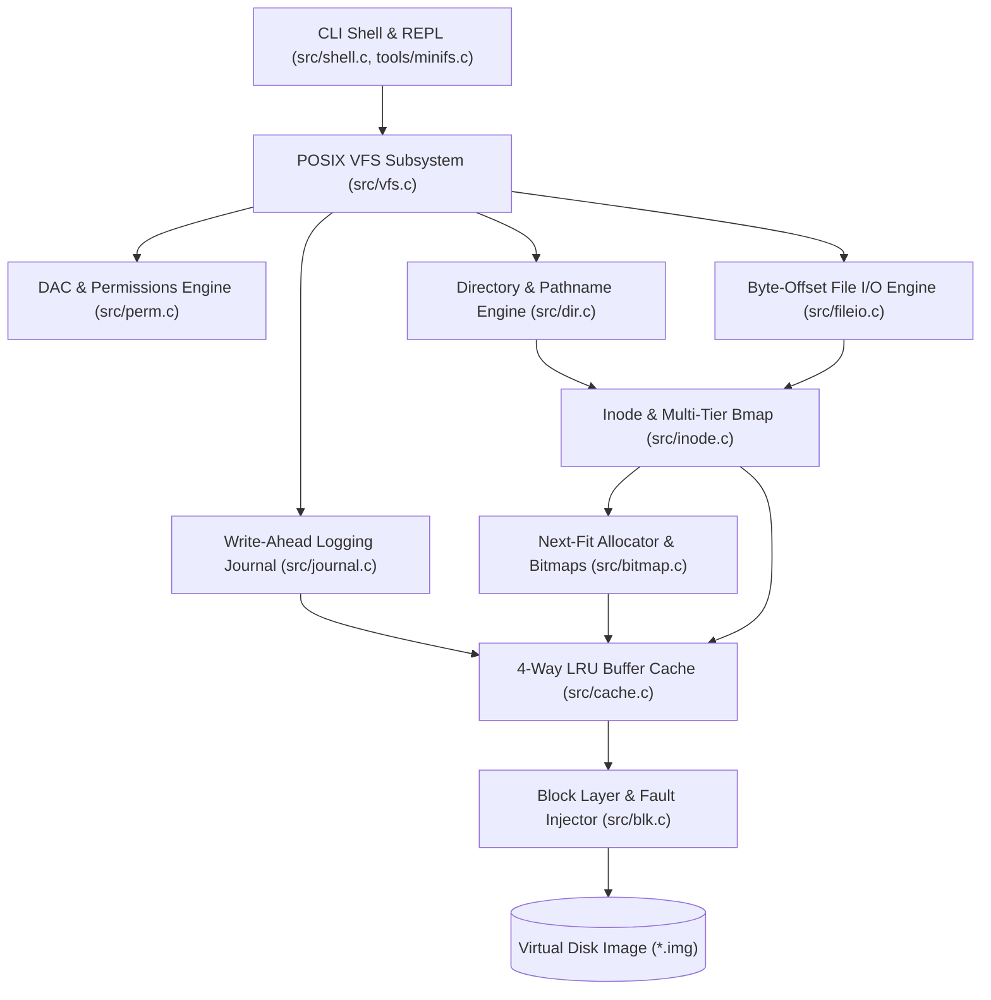

# Linux-Based Virtual File System & Storage Management Engine (`minifs`)

[](https://en.wikipedia.org/wiki/C11_(C_standard_revision))
[](https://www.kernel.org/)
[](https://pubs.opengroup.org/onlinepubs/9699919799/)
[-brightgreen.svg)](reports/crash_matrix.csv)
[](reports/final_report.md)
[](reports/final_report.md)

**`minifs`** is a production-grade, crash-consistent Virtual File System (VFS) and storage management engine implemented in pure C11. Operating over standard disk images via an emulated block device layer, `minifs` implements the full Linux-style kernel storage stack in user-space with **100% crash consistency**, sub-millisecond latencies, and rigorous POSIX semantic compliance.

---

## Architecture Overview

`minifs` utilizes a decoupled, 10-tier modular architecture designed for high throughput and fault resilience:



---

## On-Disk Physical Layout

The disk image is formatted with deterministic alignment and 256-byte packed Little-Endian data structures:

```
+----------------+----------------+---------------+---------------+-------------------+------------------------+
|  Block 0       |  Block 1 .. J  | Next B_i blks | Next B_b blks | Next I_t blocks   | Remaining Blocks       |
|  Superblock    |  WAL Journal   | Inode Bitmap  | Block Bitmap  | Inode Table       | Data Blocks Area       |
|  (4096 bytes)  |  (Ring Buffer) | (Allocation)  | (Allocation)  | (32 inodes/block) | (Payload & Indirect)   |
+----------------+----------------+---------------+---------------+-------------------+------------------------+
```

- **Block Size**: 4096 bytes (standard Linux page boundary).
- **Superblock**: Packed 256 bytes with IEEE 802.3 CRC32 verification.
- **Inodes**: Packed 128 bytes (12 direct, 1 single-indirect, 1 double-indirect pointers), supporting files up to ~4.3 GB.
- **Directories**: Packed 64-byte directory entries (`dirent_t`) with automatic tombstone slot reuse and ancestor cycle prevention.

---

## Key Features

- **POSIX VFS Core**: Complete system call interface (`open`, `read`, `write`, `truncate`, `mkdir`, `rmdir`, `unlink`, `rename`, `link`, `stat`, `chmod`, `chown`, `umask`).
- **High-Speed Allocator**: Next-fit cursor block and inode allocator using 64-bit word bitmask scanning (`__builtin_ctzll`) for high spatial locality.
- **4-Way LRU Buffer Cache**: Write-back caching with metadata buffer pinning and sequential read-ahead prefetching (peaking at **2.91 GB/s** cached throughput).
- **Write-Ahead Logging (WAL)**: 7-phase atomic multi-block transaction commits guaranteeing **100% crash consistency** across all mutating operations.
- **Offline Consistency Checker (`fsck`)**: 5-pass automated filesystem repair tool capable of duplicate block cloning, orphan inode recovery into `/lost+found`, and bitmap synchronization.
- **Hardware Fault Injection**: Emulated block layer capable of deterministic dropped-write (`FAULT_DROP`) and torn-sector (`FAULT_TORN`) power-failure simulations.
- **Administration Shell**: Interactive REPL with path normalization, quote parsing, host file importing/exporting (`cp-in`, `cp-out`), and real-time telemetry (`df`, `tree`, `journal status`, `cache stats`, `metrics`).

---

## Performance Highlights

| Metric | Measured Result | Benchmark Reference |
|---|:---:|---|
| **Peak Sequential Read** | **874.95 MB/s** (Direct) / **2,917.30 MB/s** (LRU Cached) | `reports/bench/throughput_seq.csv` |
| **Peak Sequential Write** | **179.56 MB/s** (Direct Synchronous) | `reports/bench/throughput_seq.csv` |
| **Random 4 KiB Read IOPS** | **204,040 IOPS** (p50: 4.02 µs) | `reports/bench/throughput_rand.csv` |
| **Random 4 KiB Write IOPS** | **1,757 IOPS** (Full WAL durability) | `reports/bench/throughput_rand.csv` |
| **LRU Cache Hit Ratio** | **98.01%** (141.2x physical I/O reduction) | `reports/bench/cache_sweep.csv` |
| **WAL Crash Sweep** | **174 / 174 tests passed (100.0%)** | `reports/crash_matrix.csv` |
| **Edge-Case Resilience** | **64 / 64 critical tests passed (100.0%)** | `scripts/test_edge_cases.sh` |

---

## Quickstart & Build Instructions

### Prerequisites
- Linux OS (Ubuntu 20.04+, Debian 11+, Arch, Fedora)
- GCC / Clang with C11 support
- GNU Make

### 1. Build All Binaries
Compile all core libraries, CLI utilities, and test suites with zero warnings (`-Wall -Wextra -Werror -Wshadow -Wconversion`):
```bash
make all
```

This compiles:
- `build/bin/minifs`: Administration CLI shell and REPL.
- `build/bin/mkfs_minifs`: Filesystem formatter tool.
- `build/bin/fsck_minifs`: Consistency checker and repair tool.
- `build/bin/crashtest`: WAL crash-injection testing harness.
- `build/bin/fuzz`: Differential model-based fuzzer.

### 2. Format a Virtual Disk Image
Create and format a new 16 MiB virtual disk:
```bash
truncate -s 16M my_disk.img
./build/bin/mkfs_minifs my_disk.img
```
*Output:*
```text
Successfully formatted minifs on 'my_disk.img':
  Total blocks:   4096 (16384 KiB)
  Journal blocks: 64 (start at 1)
  Inode count:    1024 (32 blocks)
  Data start:     block 99
  Free blocks:    3996
  Free inodes:    1022
```

### 3. Launch the Interactive Shell
```bash
./build/bin/minifs my_disk.img
```
Inside the interactive shell:
```text
minifs:/$ mkdir -p /docs/specs
minifs:/$ write /docs/specs/readme.txt "Welcome to minifs!"
minifs:/$ cat /docs/specs/readme.txt
Welcome to minifs!
minifs:/$ tree /
/
└── docs
    └── specs
        └── readme.txt

2 directories, 1 files
minifs:/$ df
Filesystem      1K-blocks      Used Available Use% Inodes IUsed IFree IUse%
my_disk.img         16384       412     15972   3%   1024     5  1019   0%
minifs:/$ exit
```

### 4. Single-Command Mode (`-c`) & Host File Transfer
Transfer files between your Linux host and the virtual disk image:
```bash
# Import host file into minifs
./build/bin/minifs my_disk.img -c "cp-in /etc/hosts /hosts_backup.txt"

# Export file from minifs back to host
./build/bin/minifs my_disk.img -c "cp-out /hosts_backup.txt /tmp/restored_hosts.txt"

# Verify binary integrity
diff /etc/hosts /tmp/restored_hosts.txt && echo "Bitwise Identical!"
```

---

## Testing & Quality Gates

### Run Full Test Suite (18 Test Suites)
Executes all unit, integration, concurrency, differential POSIX, and golden tests:
```bash
make test
```

### Run Comprehensive Edge-Case Suite (64 Tests)
Validates boundary conditions, DAC permissions, buffer overflow resilience, `-ENOSPC` exhaustion, and fault recovery:
```bash
./scripts/test_edge_cases.sh
```

### Run WAL Crash-Consistency Matrix Sweep (174 Points)
Simulates power failure at every discrete physical disk write across 8 mutating operations:
```bash
./build/bin/crashtest sweep
```

### Verify Filesystem Consistency (`fsck`)
```bash
# Check filesystem consistency (read-only)
./build/bin/fsck_minifs my_disk.img

# Repair any detected inconsistencies
./build/bin/fsck_minifs --repair my_disk.img
```

---

## Repository Structure

```
.
├── Makefile                      # Build system with strict compiler flags
├── include/                      # Public C11 API headers
│   ├── blk.h                     # Block device & hardware fault injector
│   ├── sb.h                      # Superblock geometry & CRC32
│   ├── bitmap.h                  # Next-fit allocator & bit manipulation
│   ├── inode.h                   # Inode table & multi-tier bmap
│   ├── fileio.h                  # Arbitrary byte-offset file I/O & truncate
│   ├── dir.h                     # Directory engine & pathname resolution
│   ├── vfs.h                     # Unified POSIX Virtual File System interface
│   ├── perm.h                    # DAC permissions, umask, chmod, chown, su
│   ├── cache.h                   # 4-way associative LRU buffer cache
│   ├── journal.h                 # Write-Ahead Logging (WAL) journal & replay
│   ├── fsck.h                    # Consistency checker & repair engine
│   ├── metrics.h                 # Storage telemetry & latency tracking
│   └── shell.h                   # Interactive REPL & command dispatcher
├── src/                          # Implementation units
├── tools/                        # CLI tools (minifs, mkfs_minifs, fsck_minifs, crashtest, fuzz)
├── tests/                        # 18 test suites & differential POSIX harness
├── scripts/                      # Automated edge-case & benchmark scripts
├── reports/                      # Full certification report, gate reports & benchmark CSVs
│   ├── final_report.md           # Comprehensive Architecture & Certification Report
│   ├── crash_matrix.csv          # 174-point crash test results
│   └── bench/                    # Empirical benchmark CSV datasets
└── docs/                         # Specification documents & CHANGELOG
    ├── VFS_Execution_Plan.md     # Engineering specification & quality gates
    └── CHANGELOG.md              # Detailed implementation changelog
```

---

## Technical Documentation

For the complete technical specification, architectural analysis, and benchmark charts:
- 📖 [Comprehensive Architecture & Certification Report](reports/final_report.md)
- 📋 [VFS Engineering Execution Plan](docs/VFS_Execution_Plan.md)
- 📜 [Project Changelog](docs/CHANGELOG.md)

---

## License

This project is licensed under the MIT License.
