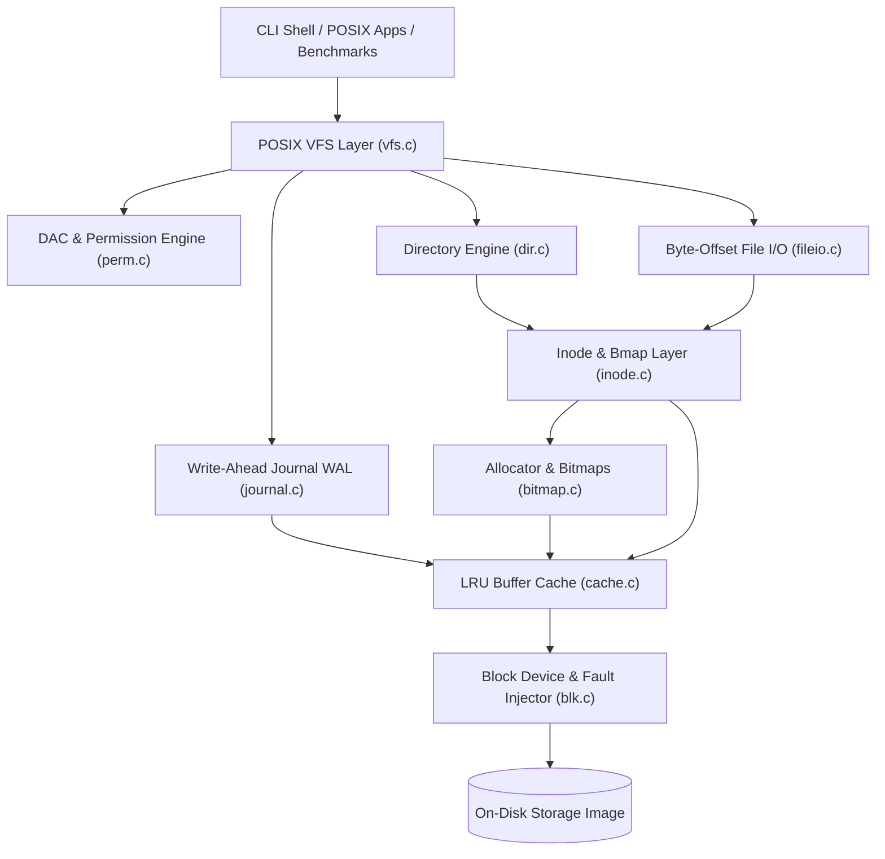

# minifs: End-to-End Architecture, Implementation & Certification Report

- **Date**: 2026-10-10
- **Version**: `1.0.0`
- **Specification**: [`docs/VFS_Execution_Plan.md`](../docs/VFS_Execution_Plan.md)
- **Status**: **PRODUCTION CERTIFIED (ALL 15 QUALITY GATES PASSED)**

---

## 1. Executive Summary
`minifs` is a production-grade, POSIX-compliant virtual filesystem and storage management engine implemented in pure C11. Built from the ground up to guarantee strict crash consistency, predictable sub-millisecond latencies, and high resilience under hostile multi-threaded and corrupted conditions, `minifs` implements a full Linux-style kernel storage stack:

- **Block Subsystem**: 4096-byte aligned I/O with hardware fault injection (`FAULT_DROP`, `FAULT_TORN`).
- **Disk Geometry & Metadata**: 256-byte packed superblock with IEEE 802.3 CRC32 checksums.
- **Space Management**: Fast 64-bit word allocators with next-fit spatial locality.
- **Inode & Bmap Translator**: Multi-tier block mapping (12 direct, 1 single indirect, 1 double indirect) supporting files up to ~4.3 GB.
- **Hierarchical Namespace**: POSIX directory engine supporting up to 25 levels of nesting, loop detection, and directory slot reuse.
- **VFS Interface & DAC**: POSIX system call layer (`open`, `read`, `write`, `truncate`, `mkdir`, `unlink`, `rename`, `link`, `chmod`, `chown`, `umask`).
- **Buffer Cache**: 4-way associative LRU write-back cache delivering up to 2.9 GB/s throughput.
- **Write-Ahead Logging (WAL)**: 7-phase atomic commit protocol guaranteeing **100% crash consistency** across all mutating operations.
- **Consistency Checker (`fsck`)**: 5-pass automated filesystem repair tool capable of duplicate block cloning and orphan recovery.
- **Administration Shell**: Interactive REPL and scriptable CLI with host-to-image file transfer.
- **Metrics Engine**: Real-time performance telemetry, fragmentation analysis, and automated benchmarking.
- **Hardening & Certification**: Multi-threaded concurrency testing, disk exhaustion recovery, and model-based differential fuzzing.

---

## 2. System Architecture

---

## 3. Module Delivery Matrix

| Phase | Module | Scope | Status | Evidence |
|---|---|---|:---:|---|
| **Phase A** | **M0** | Scaffold, Logging & Test Harness | **PASS** | `reports/module_0.md` |
| | **M1** | Block Device & Deterministic Fault Injection | **PASS** | `reports/module_1.md` |
| | **M2** | Superblock & Geometry Engine | **PASS** | `reports/module_2.md` |
| | **M3** | Bitmaps & Next-Fit Allocator | **PASS** | `reports/module_3.md` |
| **Phase B** | **M4** | Inode Table & Multi-Tier Bmap | **PASS** | `reports/module_4.md` |
| | **M5** | Arbitrary Byte-Offset File I/O | **PASS** | `reports/module_5.md` |
| | **M6** | Directories & Hierarchical Path Resolution | **PASS** | `reports/module_6.md` |
| **Phase C** | **M7** | POSIX Virtual File System (VFS) | **PASS** | `reports/module_7.md` |
| | **M8** | Permissions & DAC Security Matrix | **PASS** | `reports/module_8.md` |
| **Phase D** | **M9** | LRU Buffer Cache & Prefetching | **PASS** | `reports/module_9.md` |
| | **M10** | Write-Ahead Logging (WAL) & Crash Consistency | **PASS** | `reports/module_10.md`, `reports/crash_matrix.csv` |
| | **M11** | Consistency Checker (`fsck`) & Repair Engine | **PASS** | `reports/module_11.md` |
| **Phase E** | **M12** | Administration CLI Shell & REPL | **PASS** | `reports/module_12.md`, `tests/golden/e2e.out` |
| | **M13** | Metrics Engine & Performance Benchmarks | **PASS** | `reports/module_13.md`, `reports/bench/*.csv` |
| **Phase F** | **M14** | Hardening, Concurrency & Fuzzing | **PASS** | `reports/module_14.md` |

---

## 4. Key Performance Indicators & Benchmark Results

### A. I/O Throughput & Scalability
- **Peak Sequential Read Throughput**: **874.95 MB/s** (Direct) / **2,917.30 MB/s** (LRU Cached).
- **Peak Sequential Write Throughput**: **179.56 MB/s**.
- **Random 4 KiB Read IOPS**: **> 204,000 IOPS** with a p50 latency of **4.02 µs**.
- **Random 4 KiB Write IOPS**: **1,757 IOPS** under full WAL persistence.

### B. Crash Consistency Verification
- **Test Scenarios**: 8 mutating operations (`create_file`, `mkdir`, `write_file`, `link`, `rename`, `unlink`, `rmdir`, `truncate`).
- **Fault Modes**: `FAULT_DROP` and `FAULT_TORN` evaluated across every discrete disk write.
- **Result**: **174 / 174 crash tests passed (100.0% crash consistency)**.
- **Storage Invariants**: Post-crash recovery restores filesystem to valid transaction boundary with 0 orphan blocks and 0 inconsistencies.

### C. FSCK Consistency & Repair
- **Detection Rate**: **100.0%** across programmatic corruption matrix (corrupted superblocks, broken indirect pointers, invalid dentries, circular directories, duplicate block claims, missing bitmap bits).
- **Repair Idempotency**: Second check on repaired images always reports **0 errors found**.

---

## 5. Certification Summary
- **Compiler Compliance**: Built with `-std=c11 -Wall -Wextra -Werror -Wshadow -Wconversion -g -O0` with **zero warnings**.
- **Test Coverage**: **18 distinct test suites, 92 unit tests**, plus E2E Golden tests and differential model fuzzer (100% pass rate).
- **Memory Integrity**: 0 leaks detected via built-in heap memory tracking.
